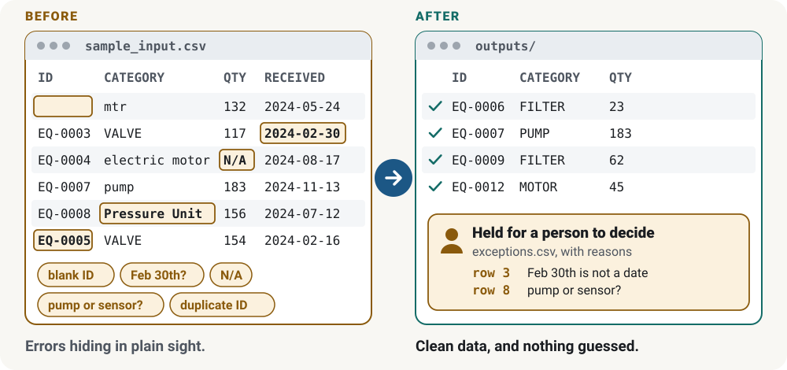

# Synthetic Data Quality Pipeline

**Cleans what it safely can and hands everything else to a person, with the reason attached.**

[Read the case study](https://h-yang-26.github.io/projects/synthetic-data-quality-pipeline/) · [How this was built](#how-this-was-built) · [Portfolio](https://h-yang-26.github.io/)

<picture>
  <source media="(prefers-color-scheme: dark)" srcset="docs/before-after-dark.svg">
  
</picture>

*Real rows from this project’s fictional sample data. Figure from the portfolio site, drawn from `data/sample_input.csv` and `outputs/`.*

A small Python pipeline that migrates inconsistent records from a **fictional** equipment-inventory CSV into a clean canonical CSV. Rows that are ambiguous or invalid are **not repaired by guessing**; they go to a separate exceptions file for human review, with their source row number, raw values and error codes.

Everything here is invented: the generator, the data, the category names and the alias table. It describes this demo only, not any production system.

## Quick start (Windows PowerShell)

Requires Python 3.11+ (developed and tested on Python 3.13.15, Windows 11; also tested on Ubuntu 24.04 with Python 3.13.18, see below).

```powershell
py -m venv .venv
.venv\Scripts\python -m pip install -r requirements.txt
.venv\Scripts\python -m dq_pipeline demo
.venv\Scripts\python -m pytest
```

`demo` regenerates the fictional input (`data/sample_input.csv`, seed 42) and mapping (`data/reference_mapping.csv`), then writes `outputs/`. Use `generate` or `run` separately, e.g. `python -m dq_pipeline run --input my.csv --mapping my_map.csv --output-dir out`.

### macOS / Linux

```bash
python3 -m venv .venv
.venv/bin/python -m pip install -r requirements.txt
.venv/bin/python -m dq_pipeline demo
.venv/bin/python -m pytest
```

Tested by Claude on Ubuntu 24.04 with Python 3.13.18 (2026-10-29): all 21 tests pass, and `demo` reproduces the committed `data/` and `outputs/` files byte for byte. The same commands should work on macOS, but it has not been tested.

Exit codes: **0** = processing completed (row exceptions are normal, reviewable output); **2** = fatal file/configuration error (missing file, missing or duplicate input columns, invalid mapping file: wrong header, empty alias, a row without exactly two fields, or a target that is not a permitted category). Input/configuration validation finishes before any output is written. An output I/O failure can leave partial files; correct the destination and rerun all outputs before using them. Each successful run **replaces** `cleaned_records.csv`, `exceptions.csv` and `summary.json`.

## Flow

`source CSV -> normalize (trim, collapse spaces) -> deterministic mapping -> validation -> cleaned_records.csv OR exceptions.csv`

Code: `dq_pipeline/io.py` (read/write), `normalize.py`, `mapping.py`, `validate.py`, `pipeline.py` (pure orchestration), `generate.py`, `cli.py`.

## Data definitions

Input columns: `record_id, category, item_name, quantity, received_date`.

| Output field | Definition |
| --- | --- |
| `source_row_number` | 1-based index of the data row in the input file (header excluded). Independent of `record_id`; identifies rows whose IDs are missing or duplicated. Completely empty lines are skipped and not counted. |
| `record_id` | Business ID, trimmed. Case is significant. |
| `product_category` | One of `FILTER, MOTOR, PUMP, SENSOR, VALVE`. |
| `item_name` | Trimmed, internal whitespace collapsed. Required. |
| `quantity` | Nonnegative whole number written with ASCII digits `0-9` only. Blank = missing (rejected). `0` = valid explicit zero. Decimals, negatives, signs, text and non-ASCII digits (e.g. Arabic-Indic `٣`) are invalid; nothing is truncated or defaulted. |
| `received_date` | `YYYY-MM-DD` with ASCII digits `0-9` only, trimmed, must be a real calendar date. No other format is accepted, so `03/04/2024` is rejected rather than read as March 4 or April 3, and dates written with non-ASCII digits (e.g. Arabic-Indic or fullwidth) are rejected with `INVALID_DATE`. |

Policies (invented for this exercise): a missing ID rejects the row; **every** occurrence of a duplicated trimmed ID is rejected.

### Category mapping

Category text is whitespace-collapsed and case-folded, then matched **exactly** against the five canonical names plus `data/reference_mapping.csv` (`alias,product_category`). Mapping header names are trimmed before checking, the same as input-file headers, so ` alias , product_category ` is accepted; any other header is a fatal error (exit 2). Outcomes: *mapped* (one target), *unknown* (`UNKNOWN_CATEGORY`), *ambiguous* (alias with more than one target, `AMBIGUOUS_CATEGORY`; the sample has `pressure unit` -> `PUMP` and `SENSOR`). No fuzzy matching. See [docs/why_ambiguous_records_need_review.md](docs/why_ambiguous_records_need_review.md).

### Exceptions encoding

One row per rejected source row. `error_codes` joins codes with `;`; `error_messages` joins explanations with ` | `. Codes: `MALFORMED_ROW, MISSING_ID, DUPLICATE_ID, MISSING_CATEGORY, UNKNOWN_CATEGORY, AMBIGUOUS_CATEGORY, MISSING_ITEM_NAME, MISSING_QUANTITY, INVALID_QUANTITY, MISSING_DATE, INVALID_DATE`.

### Summary

`summary.json` has `input_rows = accepted_rows + rejected_rows` (`reconciled: true`), plus `issue_count` (total issues, which can exceed `rejected_rows` when a row has several), counts by code and accepted counts by category. It contains no timestamps, so outputs are byte-identical across runs. Row ordering is by `source_row_number`.

## Example (fictional)

Data row 2 of the sample input has a blank ID:

```
,mtr,Servo motor,132,2024-05-24
```

becomes this `exceptions.csv` row (not cleaned, not guessed):

```
2,,mtr,Servo motor,132,2024-05-24,MISSING_ID,record_id is blank
```

A valid row, `EQ-0009,flt,Air filter  ,62,2024-01-22` (alias `flt`, trailing spaces), appears in `cleaned_records.csv` as:

```
9,EQ-0009,FILTER,Air filter,62,2024-01-22
```

## Tests

`tests/test_pipeline.py` uses a 12-row hand-checkable fixture (`tests/fixtures/`) whose expected output was derived by hand, and covers mapped/ambiguous/unknown categories, missing vs zero quantity, missing/duplicate IDs, invalid category and date, non-ASCII digits in dates and quantities, padded mapping headers, reconciliation, repeatability, output replacement and fatal exit codes. Tests run offline.

The test comparing the generated sample to the committed `data/` files assumes the seeded generator output is stable; it only uses `random.random()` for that reason.

## Limitations

Toy scale (60 rows), single-file, in-memory; one invented policy set; no fuzzy matching, UI, database or review workflow. Tested on Windows 11 and Ubuntu 24.04 with Python 3.13; not tested on macOS.

## How this was built

All data in this project is fictional, and the results say nothing about my employer’s systems. The project was built independently of my employer: ChatGPT and Claude helped with design and planning, Codex and Claude Code did the technical work under my direction, and I made the judgment calls and approved the results. [How these were built](https://h-yang-26.github.io/how-these-were-built/) on the portfolio site explains who decided what and how the results were checked.

## Attribution

Python standard library only at runtime; `pytest` (MIT) for tests. All data fictional and generated here. No repository license has been selected; no general reuse license is granted.
